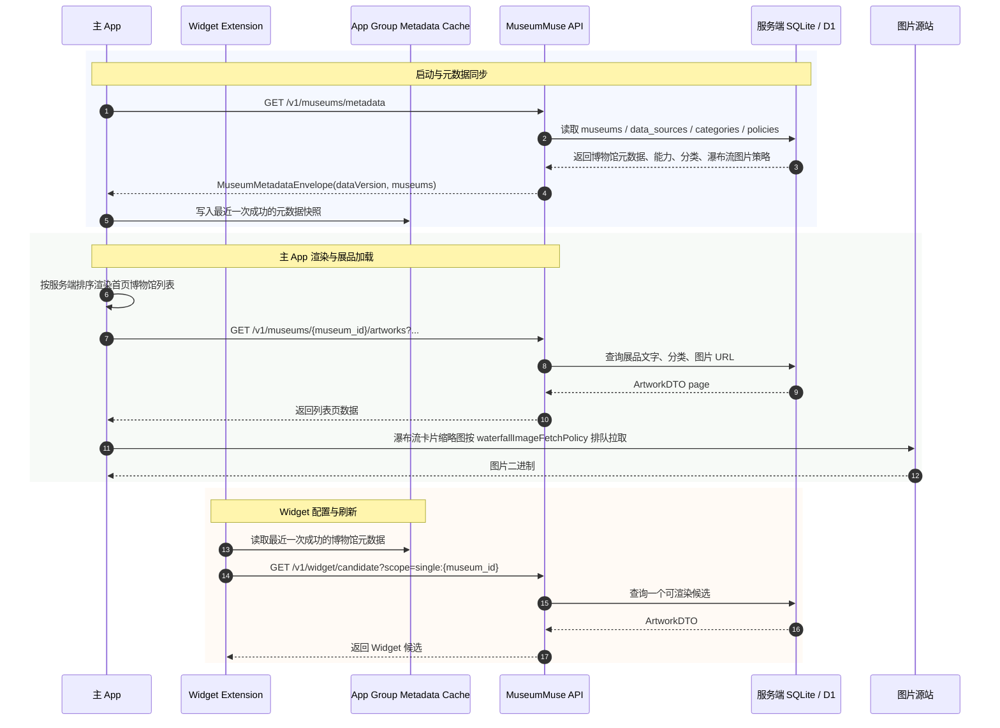

# 客户端动态博物馆元数据改造说明



## 1. 目标

本改造的目标是把客户端从“博物馆枚举 + 各馆分支逻辑”改成“服务端元数据驱动的通用渲染器”。

客户端不再用编译期全集枚举决定正式博物馆列表。博物馆名称、图标、地址、排序、数据源、分类、能力开关、详情页翻译语言、文本标点风格、Widget 图片策略和瀑布流图片拉取策略都从服务端获取。本地只负责：

- 渲染服务端返回的博物馆、分类、展品和图片 URL。
- 存储用户设置，例如选中的 `museum_id`、`source_key`、`category_id`、展示模式和 Widget scope。
- 在二级页瀑布流中按当前博物馆的图片策略排队拉取缩略图。
- 发起详情、收藏、深链接、Widget 刷新等通用行为。

本设计不考虑旧版本兼容。不保留 `MuseumID` 静态 fallback，不迁移旧 Widget 配置，不保证旧 UserDefaults key 继续可读。交付时可以清空或重建本地设置。

## 2. 非目标

- 不做全局图片 QPS 限流。
- 不限制详情页主图、全屏预览图或 Widget 图片拉取。
- 不让客户端重新直连各馆官方 API 或官网 HTML。
- 不在客户端保留各馆分类映射、源站请求参数、详情解析规则。
- 不为了兼容旧 App 版本保留旧接口语义。

## 3. 核心原则

- `museum_id` 是服务端下发的稳定字符串；Swift 侧使用 `MuseumIdentifier` 字符串包装，不再使用 `CaseIterable` enum 作为全集。
- 客户端所有设置 key 都以字符串 ID 组合，不依赖 `CaseIterable`。
- `全部` 仍是客户端 UI 聚合态，不作为真实分类从服务端返回。
- 特殊馆逻辑必须服务端显式表达，客户端不能再写 `if museumID == "met"` 这类产品规则分支，也不能保留 `.met` / `.nmc` 等静态常量作为本地全集或 fallback。
- 瀑布流图片 QPS 只作用于二级页卡片缩略图加载，不影响其它图片场景。
- 瀑布流图片默认不限流；只有服务端为当前博物馆指定 QPS 时才按该 QPS 排队拉取。
- Widget 读取 App Group 中最近一次成功的 metadata 快照，避免配置页依赖主 App 内存状态。

## 4. 服务端元数据契约

新增或替换现有博物馆元数据接口：

```http
GET /v1/museums/metadata
```

响应需要一次返回客户端渲染首页、二级页设置、Widget 配置所需的博物馆元信息。分类数量当前可控，首版可以随 metadata 一起返回；后续如果分类过大，再拆出按馆增量接口。

```json
{
  "dataVersion": "2026-06-20T10:30:00+08:00",
  "data": {
    "museums": [
      {
        "museumID": "met",
        "displayName": "大都会艺术博物馆",
        "subtitle": "纽约",
        "country": "美国",
        "city": "纽约",
        "address": "1000 5th Ave, New York, NY",
        "textPunctuationStyle": "western",
        "icon": {
          "url": "https://example.com/museums/met/icon.png",
          "assetName": "MetHomepageLogo",
          "backgroundColor": "#F4EFE8"
        },
        "sortOrder": 30,
        "capabilities": {
          "supportsWidgetContent": true,
          "supportsTranslation": true,
          "supportsFavorites": true
        },
        "defaultSourceKey": "met_all",
        "sources": [
          {
            "sourceKey": "met_all",
            "displayName": "全部展品",
            "isDefault": true,
            "translationSourceLanguage": "en",
            "preferredImageURLOrder": ["primary", "thumbnail"],
            "imageRequestHeaders": {}
          },
          {
            "sourceKey": "met_on_view",
            "displayName": "在展展品",
            "isDefault": false,
            "translationSourceLanguage": "en",
            "preferredImageURLOrder": ["primary", "thumbnail"],
            "imageRequestHeaders": {}
          }
        ],
        "categories": [
          {
            "sourceKey": "met_all",
            "categoryID": "asian-art",
            "displayName": "亚洲艺术",
            "sortOrder": 50
          }
        ],
        "waterfallImageFetchPolicy": {
          "qps": null
        }
      }
    ]
  }
}
```

字段说明：

| 字段 | 必填 | 说明 |
| --- | --- | --- |
| `museumID` | 是 | 稳定字符串 ID，用于设置、收藏、深链接、请求路径 |
| `displayName` | 是 | 首页、详情页、收藏分组展示名 |
| `subtitle` | 是 | 首页副标题，当前通常为城市 |
| `country` / `city` | 是 | 首页分组和辅助展示 |
| `address` | 否 | 博物馆地址；缺失时客户端隐藏地址展示 |
| `textPunctuationStyle` | 是 | 文本标点风格，当前为 `western` 或 `chinese` |
| `icon.url` | 否 | 博物馆图标 URL；优先级高于本地 asset |
| `icon.assetName` | 否 | 服务端下发的客户端本地图标资源名；当前六馆先使用现有首页 logo asset |
| `icon.backgroundColor` | 否 | 图标占位或徽章背景色 |
| `sortOrder` | 是 | 首页、Widget 配置默认排序 |
| `capabilities.supportsWidgetContent` | 是 | 是否可出现在 Widget scope 中 |
| `capabilities.supportsTranslation` | 是 | 详情页是否展示系统翻译入口 |
| `defaultSourceKey` | 是 | 默认数据源 |
| `sources` | 是 | 当前馆可选数据源，包含翻译源语言、图片 URL 优先级和图片请求头；源站过滤语义只留在服务端内部 |
| `categories` | 是 | 真实分类列表，不包含 `全部`；客户端只需要稳定 `categoryID` 和展示名 |
| `waterfallImageFetchPolicy` | 是 | 二级页瀑布流缩略图 QPS 策略 |

瀑布流图片策略字段：

| 字段 | 说明 |
| --- | --- |
| `qps` | 可空；为空表示不限流；大于 `0` 时表示当前博物馆瀑布流缩略图每秒最多启动的图片请求数 |

该策略不是全局 QPS，也不是源站 API QPS。它只控制二级页瀑布流卡片缩略图的客户端请求启动节奏。首版只有中国国家博物馆配置 `qps=1`，其它博物馆保持 `qps=null`，即不限流。

## 5. 服务端存储调整

现有 `museums`、`data_sources`、`categories` 已经覆盖一部分字段。为了支撑客户端去枚举，需要补齐以下服务端字段或等价 JSON 配置。

### 5.1 `museums`

| 字段 | 类型 | 说明 |
| --- | --- | --- |
| `museum_id` | `TEXT` | 稳定 ID |
| `display_name` | `TEXT` | 中文馆名 |
| `country` | `TEXT` | 国家 |
| `city` | `TEXT` | 城市 |
| `subtitle` | `TEXT` | 首页副标题 |
| `address` | `TEXT` | 地址，可空 |
| `icon_url` | `TEXT` | 图标 URL，可空 |
| `icon_asset_name` | `TEXT` | 本地图标资源名，可空 |
| `icon_background_color` | `TEXT` | 图标背景色，可空 |
| `text_punctuation_style` | `TEXT` | 文本标点风格；默认 `western`，国博 / 上海等中文源可配置为 `chinese` |
| `supports_translation` | `INTEGER` | 是否支持翻译 |
| `supports_widget_content` | `INTEGER` | 是否支持 Widget |
| `supports_favorites` | `INTEGER` | 是否支持收藏，默认 `1` |
| `sort_order` | `INTEGER` | 展示排序 |

### 5.2 `data_sources`

| 字段 | 类型 | 说明 |
| --- | --- | --- |
| `museum_id` | `TEXT` | 关联博物馆 |
| `source_key` | `TEXT` | 数据源稳定 key |
| `display_name` | `TEXT` | 页面设置展示名 |
| `is_default` | `INTEGER` | 是否默认 source |
| `translation_source_language` | `TEXT` | 详情页系统翻译源语言，可空 |
| `preferred_image_url_order_json` | `TEXT` | Widget 图片 URL 优先级，例如 `["thumbnail","primary"]` |
| `image_request_headers_json` | `TEXT` | Widget 直拉图片时需要附加的请求头 JSON，例如 `Referer` |

`data_sources` 用于替代客户端对奈良官方源 / ColBase、Japan Search 图片优先级和图片 Referer 的本地判断。

### 5.3 `museum_client_policies`

| 字段 | 类型 | 说明 |
| --- | --- | --- |
| `museum_id` | `TEXT` | 关联博物馆 |
| `waterfall_image_qps` | `REAL` | 可空；二级页瀑布流缩略图 QPS，空值表示不限流 |
| `raw_json` | `TEXT` | 预留其它客户端策略 |

首版配置：

| museum_id | waterfall_image_qps | 说明 |
| --- | --- | --- |
| `nmc` | `1` | 中国国家博物馆瀑布流缩略图每秒最多启动 1 个图片请求 |
| 其它馆 | `NULL` | 不限制瀑布流缩略图 QPS |

### 5.4 `data_sources` 复用与过滤

`data_sources` 同时表达用户可选数据源和服务端列表过滤语义：

| 字段 | 类型 | 说明 |
| --- | --- | --- |
| `artwork_source_key` | `TEXT` | 可空；非空时表示该 source 复用另一个真实入库 source 的展品 |
| `list_filter_json` | `TEXT` | 可空 JSON；服务端列表查询时附加的过滤语义 |

大都会当前配置为 `met_all` 和 `met_on_view` 两个 source。`met_all` 是真实入库源；`met_on_view` 设置 `artwork_source_key=met_all` 且 `list_filter_json={"only_on_view":true}`，列表查询时复用同一批展品并过滤 `artworks.is_on_view=1`。奈良馆的 `official` / `colbase` 是两个真实入库源。客户端只展示 `sources` 列表，不再支持单独的页面选项开关。

## 6. 客户端模型改造

### 6.1 字符串化 `MuseumID`

Swift 中的 `MuseumID` 已经收敛为 `MuseumIdentifier` 的 typealias。它是字符串包装类型，不再提供 `CaseIterable` 全集，也不提供 `.met`、`.tnm`、`.nmc` 等静态常量。

```swift
struct MuseumIdentifier: RawRepresentable, Hashable, Codable, Sendable, Identifiable {
    let rawValue: String
    var id: String { rawValue }
}

typealias MuseumID = MuseumIdentifier
```

新的客户端模型：

```swift
struct MuseumMetadata: Identifiable, Hashable, Codable, Sendable {
    let id: MuseumIdentifier
    let displayName: String
    let subtitle: String
    let country: String
    let city: String
    let address: String?
    let icon: MuseumIconMetadata
    let sortOrder: Int
    let capabilities: MuseumCapabilities
    let defaultSourceKey: String
    let sources: [MuseumSourceMetadata]
    let categories: [MuseumCategoryMetadata]
    let waterfallImageFetchPolicy: WaterfallImageFetchPolicy
}
```

实现约束：

- `MuseumRepository.supportedMuseums` 只从 `MuseumMetadataStore` 的快照构造；没有 metadata 时返回空集合，由首页显示加载 / 空态。
- `MuseumCategory`、`Artwork`、`WidgetMuseumScope.single`、收藏、深链接和缓存 key 都使用 `MuseumIdentifier.rawValue` 作为稳定字符串。
- 新增服务端 `museum_id` 时，客户端只要能解码 metadata 和 artwork DTO，就不需要新增 enum case。

### 6.2 删除本地枚举职责

以下职责必须从 `Shared/Museum.swift` 迁出：

| 当前职责 | 改造后来源 |
| --- | --- |
| 馆名、国家、城市、副标题 | `/v1/museums/metadata` |
| 首页排序与分组 | `/v1/museums/metadata` |
| 首页图标 | `icon.url`、`icon.assetName` 或文字占位 |
| 是否支持 Widget | `capabilities.supportsWidgetContent` |
| 是否支持翻译 | `capabilities.supportsTranslation` |
| 默认分类和可选分类 | `categories` |
| 奈良数据源 | `sources` + 本地选择的 `sourceKey` |
| 大都会全部/在展 | `sources`；过滤语义由服务端按 source 处理 |
| 瀑布流图片 QPS | `waterfallImageFetchPolicy.qps` |
| 详情页翻译源语言 | `sources.translationSourceLanguage` |
| Widget 图片 URL 优先级 | `sources.preferredImageURLOrder` |
| Widget 图片请求头 | `sources.imageRequestHeaders` |

客户端可以保留通用格式化工具，例如按国家分组、按 `sortOrder` 排序、生成 `全部` UI 分类，但不能保留具体博物馆的产品规则。

## 7. Metadata Store

新增共享元数据存储：

```swift
actor MuseumMetadataStore {
    func refresh(cachePolicy: MuseumRequestCachePolicy) async throws -> [MuseumMetadata]
    func cachedMuseums() -> [MuseumMetadata]
    func museum(id: MuseumIdentifier) -> MuseumMetadata?
    func categories(museumID: MuseumIdentifier, sourceKey: String?) -> [MuseumCategoryMetadata]
    func waterfallImageFetchPolicy(museumID: MuseumIdentifier) -> WaterfallImageFetchPolicy
}
```

职责：

- App 启动或首页出现时请求 `/v1/museums/metadata`。
- 后端 base URL 解析优先使用进程环境变量 `MUSEUMMUSE_BACKEND_BASE_URL`，没有该变量时使用 Info.plist 的 `MuseumBackendBaseURL`，便于模拟器指向本地服务验证。
- 成功后写入 App Group 中的 metadata 快照。
- Widget extension 从 App Group 读取最近一次快照。
- 没有 metadata 时主 App 显示明确加载 / 错误 / 空态；Widget 配置只保留 `所有博物馆` 虚拟项，不回退到旧静态博物馆列表。
- `dataVersion` 变化时，清理或隔离依赖旧 metadata 的 feed cache。

本设计不考虑旧设置兼容，但仍要处理服务端数据变化：

- 本地保存的 `museum_id` 不在 metadata 中：隐藏对应配置项，收藏详情进入不可用态。
- 本地保存的 `source_key` 不存在：使用服务端 `defaultSourceKey`。
- 本地保存的 `category_id` 不存在：忽略该分类；如果全部无效，则回到“全部”。

## 8. 主 App 改造

### 8.1 首页

- `MuseumListView` 从 `MuseumMetadataStore.cachedMuseums()` 渲染。
- 按 `country` 分组，组内按 `sortOrder` 排序。
- 图标优先使用 `icon.url`；没有 URL 时使用服务端下发的 `icon.assetName`；两者都缺失时使用通用占位。
- 点击博物馆后传递完整 `MuseumMetadata` 或 `MuseumIdentifier` 进入二级页。

### 8.2 二级页设置

- 分类来自 metadata 中当前 `sourceKey` 的 `categories`。
- `全部` 由客户端临时插入，语义是当前 source 下所有真实分类。
- 页面设置只在 `sources.count > 1` 时展示通用数据源选择器；奈良和大都会都走这套逻辑，其它单源博物馆不展示数据源选择。
- 大都会“全部展品 / 在展展品”是两个 source；客户端不再渲染 `仅显示展出展品` 开关。

### 8.3 列表与详情请求

列表请求继续使用后端接口。客户端只传 `source`、`category_ids` 和分页参数；source 对应的过滤逻辑由服务端 metadata / SQL 处理：

```http
GET /v1/museums/{museum_id}/artworks?source={source_key}&category_ids=a,b&limit=10&cursor=...
```

详情请求继续使用：

```http
GET /v1/museums/{museum_id}/artworks/{object_id}?source={source_key}
```

客户端不再按馆分发到 `MetMuseumAPI`、`JapanSearchAPI`、`NaraMuseumAPI`、`NationalMuseumChinaAPI`、`ShanghaiMuseumAPI`、`GuimetMuseumAPI`。这些旧 Swift 直连抓源文件已经从工程删除；解析器回归和源站规则参考收敛到 `server/crawler/museums/` 及其测试中。

## 9. 瀑布流图片 QPS 策略

二级页瀑布流图片加载需要支持按馆 QPS 控制。该控制只用于卡片缩略图；详情页主图、全屏预览图和 Widget 图片不受影响。

新增 feed 级缩略图加载协调器，并只在瀑布流卡片 `CachedAsyncImage` 传入 `waterfallMuseumID` 时启用：

```swift
actor WaterfallImageLoadCoordinator {
    func waitIfNeeded(for museumID: MuseumIdentifier?) async
}
```

规则：

- 只接管瀑布流卡片缩略图。
- 按当前 `museumID` 使用 `waterfallImageFetchPolicy.qps`。
- `qps` 为空、缺失或小于等于 `0` 时，不做限流，维持系统默认图片加载行为。
- `qps` 大于 `0` 时，对当前馆瀑布流缩略图请求做启动速率限制，启动间隔为 `1 / qps` 秒。
- 中国国家博物馆首版配置为 `qps=1`，即每秒最多启动 1 个瀑布流缩略图请求。
- 卡片离屏时仍由现有 `ImageLoader` 取消任务；缓存命中不进入限流等待。
- 详情页主图、全屏预览、Widget 图片不走该 coordinator。

策略模型：

```swift
struct WaterfallImageFetchPolicy: Codable, Hashable, Sendable {
    let qps: Double?
}
```

## 10. Widget 改造

`WidgetConfiguredMuseumScope` 使用动态 AppIntents `AppEntity`，不再用 `AppEnum + CaseIterable` 固定枚举六馆。

建议模型：

```swift
struct WidgetConfiguredMuseumScope: AppEntity {
    let id: String
    let displayName: String
}
```

Widget 配置查询从 App Group metadata 快照读取：

- `所有博物馆` 是客户端固定虚拟项。
- 单馆项来自 `capabilities.supportsWidgetContent == true` 的 metadata。
- 排序使用 `sortOrder`。
- metadata 不存在时，只展示 `所有博物馆`；主 App 成功写入 App Group metadata 快照后，Widget 配置页再展示单馆项。

Widget 刷新请求继续传字符串 scope：

```text
all
single:{museum_id}
```

Widget 不参与瀑布流图片策略。Widget 图片加载维持现有成功态、失败态、裁剪和降采样规则。

## 11. 设置与本地存储

本地设置只存稳定字符串：

| 设置 | 建议 key 组成 |
| --- | --- |
| 当前 source / 分类 | `feed.preferences.v2` JSON 中的 `{museum_id}` 条目 |
| 展示模式 | `feed.displayMode.{museum_id}` |
| Widget scope | `all` 或 `single:{museum_id}` |
| 收藏 key | `{museum_id}:{source_key}:{object_id}` |

不再遍历 `MuseumID.allCases` 导出设置。导入导出时保留 `feed.preferences.v2`、`feed.displayMode.*` 和 Widget scope 等通用动态设置。

## 12. 实施步骤

1. 定义服务端 metadata schema。
   - 验证：服务端测试覆盖所有正式馆 metadata 字段非空约束、排序、分类、source、瀑布流图片 QPS 策略。
2. 服务端补齐 metadata 查询。
   - 验证：带 simple auth 的 `GET /v1/museums/metadata` 返回完整 JSON，正式腾讯云 SCF 和本地 Python API 字段一致；如维护已退役的 `server/worker` 实现，也不得让其 metadata schema 漂移。
3. Swift 新增 `MuseumIdentifier`、`MuseumMetadata`、`MuseumMetadataStore`。
   - 验证：metadata JSON decode 单测、App Group 快照读写单测。
4. 主 App 首页改为 metadata 驱动。
   - 验证：首页按国家分组和 sortOrder 展示，图标缺失有占位。
5. 二级页分类和 source 改为 metadata 驱动。
   - 验证：多 source、多分类都能生成正确列表请求。
6. 列表、详情、收藏、深链接改用 `MuseumIdentifier`。
   - 验证：列表分页、详情打开、收藏分组、冷启动深链接全部通过。
7. 瀑布流接入 `WaterfallImageLoadCoordinator`。
   - 验证：中国国家博物馆瀑布流缩略图每秒最多启动 1 个图片请求，其它馆不做 QPS 限流。
8. Widget 配置改为动态 entity。
   - 验证：Widget 配置页可展示服务端支持的单馆 scope，刷新仍只返回当前 scope 候选。
9. 移除客户端各馆官方 API target 依赖。
   - 验证：项目编译通过，客户端不再引用各馆 API 分发逻辑。

## 13. 风险与约束

| 风险 | 影响 | 处理方式 |
| --- | --- | --- |
| metadata 字段不完整 | 客户端缺少展示或请求参数 | schema 先定稿，服务端测试强校验 |
| 服务端下发脏数据 | UI 空白、设置失效、请求失败 | 客户端对缺图标、空分类、非法 policy 做降级 |
| 特殊馆逻辑残留在客户端 | 新增馆仍需发版 | `sources`、`listFilter`、`capabilities` 必须覆盖特殊行为 |
| Widget metadata 快照为空 | Widget 配置页暂时只有所有博物馆 | 主 App 启动和首页刷新 metadata 后写入 App Group；Widget query 从快照读取单馆项 |
| 国博瀑布流缩略图突发请求 | 源站图片请求被打爆 | `museum_client_policies.waterfall_image_qps=1`，feed 级 coordinator 按 QPS 控制请求启动 |
| 删除 enum 后编译错误面大 | 改造周期变长 | 按模型、首页、二级页、详情、Widget 分阶段提交 |

## 14. 验收标准

- Swift 代码中没有 `MuseumID: CaseIterable` 作为正式博物馆来源。
- 首页展示的博物馆完全来自 `/v1/museums/metadata`。
- 新增服务端 museum metadata 后，客户端无需改 enum 即可展示首页入口、分类、列表、详情和 Widget scope。
- 二级页瀑布流缩略图请求遵守当前馆 `waterfallImageFetchPolicy.qps`。
- 中国国家博物馆瀑布流缩略图按 `QPS=1` 拉取；其它博物馆默认不限流。
- 详情页和 Widget 图片不受瀑布流策略影响。
- 客户端不再直接请求各馆官方展品 API 或官网详情 HTML。
- 设置导入导出支持动态 `museum_id`、`source_key`、`category_id`。
- 深链接使用字符串 `museum_id` 能打开对应详情页。
- Widget 配置和刷新使用动态 metadata 中 `supportsWidgetContent` 的馆列表。
