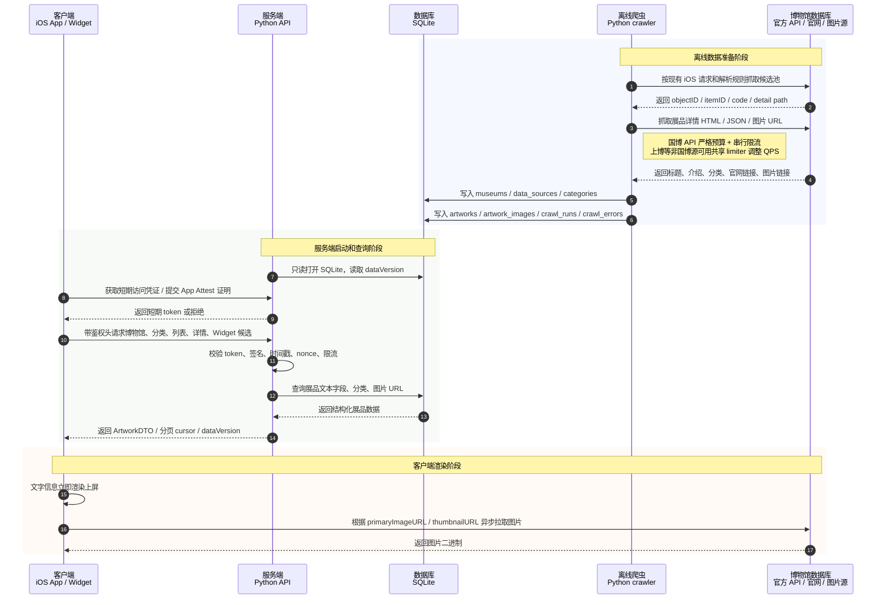

# MuseumMuse 前后端分离改造设计



## 1. 背景与目标

当前 App 和 Widget 在客户端直接访问六个博物馆的公开 API 或官网页面。这样会把网页解析、限流、候选池准备、详情字段清洗和 Widget 刷新策略都放在 iOS 端，导致以下问题：

- 客户端逻辑重，且 App / Widget 都要承受上游接口不稳定、网页结构变化和限流风险。
- 中国国家博物馆、上海博物馆这类严格限流链路在用户设备上触发，难以统一控制。
- 后续新增博物馆时，需要同时改 Swift 网络层、解析层、缓存层、Widget 和深链接分发。
- Widget 刷新必须走 network-only，但现在 network-only 仍然指向各馆官方源，失败率不可控。

本设计的目标是：

- 离线爬取当前正式支持的六馆展品信息，图片只保存 URL，不保存图片二进制。
- 用 SQLite 存储展品、分类、图片链接、源站字段和抓取元信息，保证后续可扩展。
- 用 Python 基于 SQLite 提供本地服务端 API，未来可迁移到 serverless。
- iOS 主 App 和 Widget 不再直接请求各馆官方展品接口，改为请求服务端；拿到文字信息后立即上屏，再由现有图片加载管线异步拉取图片 URL。

## 2. 范围与假设

首版覆盖当前正式支持的六馆：

- 大都会艺术博物馆：`met`
- 东京国立博物馆：`tnm`
- 奈良国立博物馆：`nnm`
- 中国国家博物馆：`nmc`
- 上海博物馆：`shm`
- 吉美国立亚洲艺术博物馆：`guimet`

关键假设：

- 奈良国立博物馆仍保留两套数据源：`official` 和 `colbase`。SQLite 中必须用 `source_key` 区分，避免收藏、深链接和 Widget 候选混淆。
- `全部` 仍然只是 UI 聚合态，不作为真实分类入库；数据库只保存远端真实分类或项目内部稳定分类。
- 首版服务端只读 SQLite，不在请求路径中实时回源官方 API。重新抓取由离线脚本完成。
- 图片二进制继续由客户端按 URL 拉取；SQLite 只保存 `primary`、`thumbnail` 等图片链接和可选宽高。

不在首版范围内：

- 图片代理、图片缓存 CDN、图片转码。
- 用户账号体系、云端收藏同步。
- 服务端在线增量爬取。
- 将 SQLite 替换为 PostgreSQL、D1 或其他数据库。

## 3. 现有客户端参考点

爬虫和客户端改造需要参考当前 Swift 代码中的数据契约，而不是重新发明字段：

- 统一展品模型：`Shared/Artwork.swift`
- 博物馆、分类和支持范围：`Shared/Museum.swift`
- 主 App 批量加载：`Shared/ArtworkFeed/ArtworkFeedViewModel.swift`
- 共享候选池与详情批加载：`DailyMuseumWidget/WidgetSettingsReader.swift` 中的 `ArtworkBatchLoader`
- 详情页按馆分发：`DailyMuseum/Views/ArtworkDetailLoaderView.swift`
- Widget 刷新与候选推进：`DailyMuseumWidget/WidgetRefreshDeliveryTracker.swift`
- 各馆源站逻辑已收敛到服务端 crawler：
  - `server/crawler/museums/met.py`
  - `server/crawler/museums/tnm.py`
  - `server/crawler/museums/nnm_official.py`
  - `server/crawler/museums/nnm_colbase.py`
  - `server/crawler/museums/nmc.py`
  - `server/crawler/museums/shm.py`
  - `server/crawler/museums/guimet.py`

爬虫脚本是源站请求参数、分页、解析和字段清洗规则的唯一实现位置，保证后端返回的 `Artwork` 语义与客户端通用模型一致。

## 4. 总体架构

首版拆成三个模块：

- `crawler`：离线 Python 爬虫，按馆抓取候选池和详情，写 SQLite。
- `server`：Python HTTP API，只读查询 SQLite。
- `client`：iOS 主 App / Widget 的统一后端客户端，替换现有官方源请求。

建议目录结构：

```text
server/
  crawler/
    __init__.py
    main.py
    rate_limit.py
    stores.py
    museums/
      met.py
      japan_search.py
      nara.py
      nmc.py
      shm.py
      guimet.py
  api/
    __init__.py
    app.py
    db.py
    models.py
    routes.py
  migrations/
    001_initial.sql
  data/
    museummuse.sqlite
    manifest.json
```

本地开发启动方式示例：

```bash
python -m server.crawler.seed_sample_data --db server/data/museummuse.sqlite
MUSEUMMUSE_DB_PATH=server/data/museummuse-live-all.sqlite MUSEUMMUSE_AUTH_MODE=simple MUSEUMMUSE_SIMPLE_AUTH_SECRET=dev-secret python -m uvicorn server.api.app:app --host 127.0.0.1 --port 8000
MUSEUMMUSE_SIMPLE_AUTH_SECRET=dev-secret python3 scripts/probe_backend_simple_auth.py --base-url http://127.0.0.1:8000
```

真实数据抓取方式示例：

```bash
python -m server.crawler.main crawl --museum all --db server/data/museummuse.sqlite --allow-network --max-details 10
python -m server.crawler.main crawl --museum all --db server/data/museummuse.sqlite --allow-network --full --skip-existing
python -m server.crawler.main crawl --museum all --db server/data/museummuse.sqlite --allow-network --full --skip-existing --exclude-museum nmc --page-size 50 --request-interval 0.1 --concurrency 10
```

`server.crawler.seed_sample_data` 只用于本地后端部署和客户端功能测试，会复用各馆 crawler parser / store 函数写入最小样本数据，不触发任何源站网络请求；正式数据交付仍以 `crawl --museum all --allow-network --max-details {明确预算}` 或 `--full --skip-existing` 生成的 SQLite 和 manifest 为准。`--max-details` 是每个数据源最多抓取的详情数，`--full` 表示遍历当前数据源发现到的完整候选池，二者不能同时使用；live crawl 必须显式传入大于 0 的 `--max-details` 或显式传入 `--full`，避免默认命令产生无详情数据的假成功。长任务续跑时应使用 `--skip-existing`，避免重复请求已入库展品详情。`--museum all` 支持重复传入 `--exclude-museum {crawler_id}` 跳过高风险来源，例如国博全量详情策略未确认时先用 `--exclude-museum nmc` 完成其它来源。`--page-size {N}` 只用于支持分页大小的候选搜索；`--request-interval {seconds}` 可用于支持该参数的非国博 crawler 调整请求间隔，`--concurrency {N}` 可用于支持该参数的非国博长详情 crawler 并发抓取详情，后续非国博来源可尝试 `--request-interval 0.1 --concurrency 10`（约 `10 QPS` 上限），若源站失败率升高则回退默认值；这两个参数禁止用于国博。上海博物馆和 Met 这类长详情任务会逐条提交，并每 `100` 个候选输出一次进度，中断后必须继续用 `--skip-existing` 续跑。全量交付前必须运行 `python -m server.crawler.main status --db {SQLite}`；只有所有正式 crawler target 都显示 `completion=complete`，才能视为全量爬取完成。本地客户端验证全量数据时，后端必须显式设置 `MUSEUMMUSE_DB_PATH=server/data/museummuse-live-all.sqlite`；不要继续指向早期每源 `10` 条的 `museummuse-live-full.sqlite`。

## 5. 离线爬虫设计

### 5.1 抓取原则

- 只抓文本、结构化字段、官网链接、图片 URL，不下载图片二进制。
- 每个展品以 `(museum_id, source_key, object_id)` 唯一标识。
- 候选池和详情页分开抓：先拿 ID / path / code，再进入详情页补齐字段。
- 每条详情都记录 `source_detail_url`、`raw_json` 或关键 HTML 摘要，方便以后重跑解析。
- 抓取过程必须可断点续跑：已存在且 `content_hash` 未变化的详情可跳过。
- 抓取失败只记录到 `crawl_errors`，不让单个展品阻断整馆抓取。

### 5.2 各馆抓取策略

| 博物馆 | source_key | 候选池来源 | 详情来源 | 特殊规则 |
| --- | --- | --- | --- | --- |
| 大都会艺术博物馆 | `met_all` | The Met `/search`，按 `departmentId` 和 `hasImages=true` | `/objects/{objectID}` + 官网 overview 兜底 | `met_on_view` 是复用 `met_all` 的客户端 source，通过 `list_filter_json={"only_on_view":true}` 过滤 `artworks.is_on_view=1`；`--category-id` 需要把项目内部分类 ID 映射为官方 `departmentId` |
| 东京国立博物馆 | `japan_search` | Japan Search `jps-cross`，小页 `size=10` | Japan Search `/item/{itemID}` | 保留 contributor 为空时退回 cobas 全库再本地过滤 |
| 奈良国立博物馆 | `official` | 馆方中文藏品页 `data-href` | 馆方详情页 `{id}.html` | `object_id` 使用 `narahaku-{原始ID}` |
| 奈良国立博物馆 | `colbase` | Japan Search / ColBase，小页 `size=10` | Japan Search `/item/{itemID}` | 与东京馆同类分页约束 |
| 中国国家博物馆 | `nmc_api` | `exhibit_list` 全部分类大页分页 | 网页 HTML / `share_link` HTML | 列表 API 反爬严格，优先用 `cate_id=0` 和最大已验证 `limit` 以最少 API 调用获取最多候选；不要按每个分类重复打列表 API；详情优先按网页抓取处理；列表摘要字段要作为详情缺字段时的回填来源 |
| 上海博物馆 | `shm_web` | `search-antique` 分页 | `article/id/{code}` + `article/aid/{code}` | 搜索、详情、图片页请求共享 limiter；用户批准后可尝试 `--request-interval 0.1 --concurrency 10`；瞬时网络失败最多重试 3 次 |
| 吉美国立亚洲艺术博物馆 | `guimet_web` | 官网分类页 `node--type-art-work` | 官网详情页 | 不混入推荐卡片、导航和页脚内容 |

### 5.3 限流要求

中国国家博物馆必须强制控制 API 总量和串行调用；上海博物馆使用共享 limiter，并可在用户批准后提高到约 `10 QPS` 上限：

- `nmc_api`：`exhibit_list` API 反爬非常严格，同一 IP 请求 API 次数过多可能被封禁；爬虫不能只依赖 1 QPS，还必须控制 API 总调用量。
- 国博候选池优先只用 `cate_id=0` 全部分类和最大已验证 `limit` 做大页分页，尽量少调 `exhibit_list`；除非全量接口字段不足且有明确预算，不要按每个分类重复调用列表 API。
- 国博列表 API 预算默认由 `MUSEUMMUSE_NMC_LIST_LIMIT=100` 和 `MUSEUMMUSE_NMC_MAX_LIST_API_CALLS=20` 控制；真实爬虫必须在每次列表 API 请求前消耗预算，预算耗尽后停止列表 API 请求。
- 国博 live crawl 带 `--max-details` 时，候选池发现只需要拿到足够支撑目标成功条数的候选后就停止，不能为了少量详情先消耗完整列表预算。
- 国博 `--full` 不允许默认通过 `share_link` API 全量打详情；除非已经确认风险并显式设置 `MUSEUMMUSE_NMC_DETAIL_FETCH_MODE=share_link_api` 和 `MUSEUMMUSE_NMC_ALLOW_FULL_SHARE_LINK_API=1`，否则应先补网页详情抓取路径或继续使用受控预算模式。
- 国博列表 item 中已经随候选返回的标题、年代、分类、尺寸、图片等摘要字段需要保留；详情 HTML 缺少 `brief` 段落时，先用已获取摘要字段回填，不能为了补字段额外按分类重复请求列表 API。
- 当前 `crawl --museum nmc` 已提供 `--sample-detail-html` 离线解析 / 入库验证路径；真实网络抓取必须显式传入 `--allow-network`。
- 国博详情 live 抓取默认不启用 `share_link` API path；如果只能走 `share_link`，必须显式设置 `MUSEUMMUSE_NMC_DETAIL_FETCH_MODE=share_link_api` 并继续消耗 API 预算。
- 国博分类关系优先从详情 HTML 或已抓字段回填；不要为了分类映射额外对每个分类打一遍列表 API。
- 国博详情优先走网页 HTML 抓取路径；如果必须访问 `share_link` 这类 API path 返回的 HTML，也要和列表 API 共用预算、串行限流并记录调用量。
- `shm_web`：`search-antique`、`article/id/{code}`、`article/aid/{code}` 使用同一个 per-museum limiter；默认保守运行，用户批准后可通过 `--request-interval 0.1 --concurrency 10` 尝试约 `10 QPS` 上限。
- 对国博不要并发详情请求；即使 Python 使用 async，也必须通过串行 limiter 获取令牌后再发请求。
- 其他博物馆可以在共享 limiter 下低并发抓取；提高并发时必须先确认源站失败率，避免触发风控。

当前 Met crawler 已支持 `crawl --museum met --sample-detail-json` 离线验证 The Met object JSON 解析和 SQLite 入库，并支持通过 `--sample-web-html` 验证官网 overview / 顶部简介 / meta description 兜底解析。真实网络抓取会在 object API 后按中文页、英文页顺序尝试官网描述；服务端 crawler 没有 WebKit 渲染兜底，若遇到 Vercel Security Checkpoint 只能保留空介绍并记录后续补抓。
Met 搜索候选池可能返回少量详情 API 不可取的 objectID；若 object detail API 稳定返回 `404` 或低速重试后长期无响应，crawler 不能伪造展品入库，应记录 `crawl_errors`，并在 run manifest 中通过 `permanentFailureCount` 计入“已遍历但源站无详情”的终端状态。全量 status 对 Met 允许 `artworkCount + permanentFailureCount == candidateCount` 视为 complete。

当前 Japan Search crawler 已支持 `crawl --museum tnm --sample-detail-json` 和 `crawl --museum nnm-colbase --sample-detail-json` 离线验证 item JSON 解析和 SQLite 入库；真实网络抓取必须显式传入 `--allow-network`，并继续保留 `size=10` 小页、contributor 空结果 fallback、provider / contributor 本地过滤和可选 `--category-id` 分类 membership 写入。

当前奈良馆方 crawler 已支持 `crawl --museum nnm-official --sample-detail-html --sample-object-id {原始ID}` 离线验证馆方详情 HTML 解析和 SQLite 入库；搜索页解析、`narahaku-` objectID、图片 URL 规范化、说明文本清洗、缺失材质行处理和官方门类 membership 需要继续与 Swift 侧规则保持一致。

当前 Guimet crawler 已支持 `crawl --museum guimet --sample-detail-html --sample-detail-url {详情页URL}` 离线验证官网详情 HTML 解析和 SQLite 入库；真实网络抓取必须显式传入 `--allow-network`，并继续保留官网分类页候选、详情页字段解析、`~` objectID 分隔和“不混入了解更多藏品”规则。

当前上海博物馆 crawler 已支持 `crawl --museum shm --sample-detail-html --sample-object-id {code}` 离线验证文章页 HTML 解析和 SQLite 入库，可选 `--sample-image-html` 补充图片页解析；真实网络抓取必须显式传入 `--allow-network`，并继续保留搜索 / 文章 / 图片请求共享 limiter、图片页失败不丢弃文字详情、搜索摘要不替代文章页详情的规则。部分文章页标题前会带 `img.jwz` 等题名字形图片，标题解析必须清理标题区内的图片、收藏链接等标签后再提取文本。

限流器伪代码：

```python
class RateLimiter:
    def __init__(self, interval_seconds: float):
        self.interval = interval_seconds
        self.next_allowed_at = 0.0
        self.lock = asyncio.Lock()

    async def wait(self) -> None:
        async with self.lock:
            now = time.monotonic()
            delay = max(0.0, self.next_allowed_at - now)
            self.next_allowed_at = max(now, self.next_allowed_at) + self.interval
        if delay > 0:
            await asyncio.sleep(delay)
```

### 5.4 抓取产物

每次完整抓取输出：

- `museummuse.sqlite`：服务端直接读取的 SQLite 文件。
- `manifest.json`：记录默认 SQLite 的数据版本、抓取时间、各馆数量、失败数量、爬虫 git commit。
- `crawl_runs` / `crawl_errors`：写入 SQLite，供服务端健康检查和排查使用。
- 当前 CLI 在成功执行任一 `crawl` 命令后会按 SQLite 当前状态写出 manifest；默认库 `museummuse.sqlite` 写出同目录 `manifest.json`，非默认库写出同目录 `{db_stem}.manifest.json`，避免多个 SQLite 在同一目录时互相覆盖 manifest。`--museum all` 只允许在显式 `--allow-network` 时顺序执行全部正式源，避免误触发真实源站请求。

`manifest.json` 示例：

```json
{
  "build_id": "2026-06-19T10:30:00+00:00",
  "schema_version": 1,
  "crawler_version": "git-sha-or-release",
  "database": "server/data/museummuse.sqlite",
  "artwork_count": 14690,
  "sources": [
    { "museum_id": "met", "source_key": "met_all", "artwork_count": 12345 },
    { "museum_id": "nmc", "source_key": "nmc_api", "artwork_count": 2345 }
  ],
  "crawl_runs": { "by_status": { "succeeded": 6 }, "latest": { "run_id": "met-..." } },
  "error_count": 15
}
```

## 6. SQLite 数据表设计

设计目标：

- 覆盖当前 `Artwork` 字段。
- 支持一个博物馆多数据源。
- 支持多分类、多图片、多扩展字段。
- 支持抓取审计、失败重试和未来新增字段。
- 让服务端常用查询有稳定索引。

文档以表格定义数据契约；后续迁移脚本可以从这些表格生成 SQL。

### 6.1 表关系总览

| 表名 | 主键 / 唯一键 | 主要关系 | 用途 | 关键索引 |
| --- | --- | --- | --- | --- |
| `schema_migrations` | `version` | 无 | 记录 SQLite schema 迁移版本 | 主键索引 |
| `museums` | `museum_id` | 被 `data_sources` 引用 | 保存正式支持博物馆元信息 | 主键索引 |
| `data_sources` | `source_pk`；唯一键 `(museum_id, source_key)` | 引用 `museums` | 区分同一博物馆的不同数据源，例如奈良 `official` / `colbase` | `(museum_id, source_key)` |
| `categories` | `category_pk`；唯一键 `(museum_id, source_key, category_id)` | 引用 `data_sources` | 保存真实分类，不保存 UI 聚合态 `全部` | `(museum_id, source_key, category_id)` |
| `artworks` | `artwork_pk`；唯一键 `(museum_id, source_key, object_id)` | 引用 `data_sources`，被图片、分类、facet 引用 | 保存展品主体字段，覆盖当前 Swift `Artwork` 模型 | `(museum_id, source_key)`、`(museum_id, object_id)`、`(museum_id, source_key, has_image)` |
| `artwork_images` | `image_pk`；唯一键 `(artwork_pk, role, url)` | 引用 `artworks` | 保存图片 URL，不保存图片二进制 | `(artwork_pk, role, sort_order)` |
| `artwork_categories` | 复合主键 `(artwork_pk, category_pk)` | 连接 `artworks` 和 `categories` | 支持一个展品属于多个分类 | `(category_pk, artwork_pk)` |
| `artwork_facets` | `facet_pk`；唯一键 `(artwork_pk, facet_kind, facet_key, remote_value)` | 引用 `artworks` | 保存源站原始 / 半结构化 facet，例如朝代、材质、地区、是否展出；首版不承诺跨馆统一语义 | `(artwork_pk, facet_kind)` |
| `crawl_runs` | `run_id` | 被 `crawl_errors` 引用 | 记录每次离线抓取任务 | 主键索引 |
| `crawl_errors` | `error_pk` | 引用 `crawl_runs` | 记录抓取失败，支持断点重跑和排查 | `(run_id, museum_id, stage)` |
| `artwork_fts` | FTS5 rowid | 关联 `artworks.artwork_pk` | 可选全文检索索引 | FTS5 内部索引 |

### 6.2 `museums`

| 字段 | 类型 | 约束 | 说明 |
| --- | --- | --- | --- |
| `museum_id` | `TEXT` | 主键 | 当前 `MuseumID.rawValue`，例如 `met`、`nmc` |
| `display_name` | `TEXT` | 非空 | 中文馆名 |
| `country` | `TEXT` | 非空 | 国家中文名 |
| `city` | `TEXT` | 非空 | 城市中文名 |
| `subtitle` | `TEXT` | 非空 | 首页副标题，当前等同城市 |
| `supports_translation` | `INTEGER` | 非空，默认 `0` | 是否支持详情页系统翻译 |
| `supports_widget_content` | `INTEGER` | 非空，默认 `1` | 是否支持 Widget 内容 |
| `sort_order` | `INTEGER` | 非空 | 首页和接口默认排序 |

### 6.3 `data_sources`

| 字段 | 类型 | 约束 | 说明 |
| --- | --- | --- | --- |
| `source_pk` | `INTEGER` | 主键，自增 | 数据源内部主键 |
| `museum_id` | `TEXT` | 非空，外键 | 所属博物馆 |
| `source_key` | `TEXT` | 非空 | 稳定数据源标识，例如 `met_all`、`met_on_view`、`official`、`colbase` |
| `display_name` | `TEXT` | 非空 | 数据源展示名，例如 `馆方数据源` |
| `is_default` | `INTEGER` | 非空，默认 `1` | 是否为该馆默认源 |
| `artwork_source_key` | `TEXT` | 可空 | 复用的真实入库 source；例如 `met_on_view` 指向 `met_all` |
| `list_filter_json` | `TEXT` | 可空 | 服务端列表过滤语义；例如 `{"only_on_view":true}` |
| `request_base_url` | `TEXT` | 可空 | 源站基础 URL，用于排查和文档展示 |
| `notes` | `TEXT` | 可空 | 数据源约束说明 |

唯一约束：`(museum_id, source_key)`。

### 6.4 `categories`

| 字段 | 类型 | 约束 | 说明 |
| --- | --- | --- | --- |
| `category_pk` | `INTEGER` | 主键，自增 | 分类内部主键 |
| `museum_id` | `TEXT` | 非空，外键组成项 | 所属博物馆 |
| `source_key` | `TEXT` | 非空，外键组成项 | 所属数据源 |
| `category_id` | `TEXT` | 非空 | 项目内部稳定分类 ID |
| `display_name` | `TEXT` | 非空 | UI 中文展示值 |
| `sort_order` | `INTEGER` | 非空，默认 `0` | 分类展示排序 |
| `raw_json` | `TEXT` | 可空 | 源站分类原始信息 |

唯一约束：`(museum_id, source_key, category_id)`。注意：`全部` 不入库，只由客户端或服务端把空 `category_ids` 解释为全选。

### 6.5 `artworks`

| 字段 | 类型 | 约束 | 说明 |
| --- | --- | --- | --- |
| `artwork_pk` | `INTEGER` | 主键，自增 | 展品内部主键 |
| `museum_id` | `TEXT` | 非空，外键组成项 | 所属博物馆 |
| `source_key` | `TEXT` | 非空，外键组成项 | 所属数据源 |
| `object_id` | `TEXT` | 非空 | 当前深链接、收藏和 Widget key 使用的 `Artwork.objectID` |
| `stable_id` | `TEXT` | 非空 | 当前 Swift `Artwork.id`，例如 `nmc-123` |
| `title` | `TEXT` | 非空 | 展品标题 |
| `artwork_description_html` | `TEXT` | 可空 | 保留 HTML 片段，供详情页清洗和换行 |
| `artwork_description_text` | `TEXT` | 可空 | 纯文本介绍，供搜索和服务端摘要 |
| `artist_display_name` | `TEXT` | 可空 | 作者 / 艺术家 |
| `object_date` | `TEXT` | 可空 | 年代 |
| `medium` | `TEXT` | 可空 | 材质 |
| `dimensions` | `TEXT` | 可空 | 尺寸 |
| `department` | `TEXT` | 可空 | 类别 / 部门展示值 |
| `culture` | `TEXT` | 可空 | 文化、地区或地点 |
| `country` | `TEXT` | 可空 | 国家 |
| `repository` | `TEXT` | 可空 | 收藏机构 |
| `object_url` | `TEXT` | 可空 | 官网详情页 URL，用于详情页官网入口、分享和 AI 快捷指令 |
| `source_detail_url` | `TEXT` | 可空 | 爬虫实际抓取的详情 URL |
| `is_on_view` | `INTEGER` | 可空 | 是否展出；当前主要用于大都会 |
| `has_image` | `INTEGER` | 非空，默认 `0` | 是否至少有一张可用图片 URL |
| `content_hash` | `TEXT` | 可空 | 详情内容 hash，用于断点续跑和变更检测 |
| `source_updated_at` | `TEXT` | 可空 | 源站更新时间，源站不提供时为空 |
| `crawled_at` | `TEXT` | 非空 | 本次抓取时间 |
| `raw_json` | `TEXT` | 可空 | 源站原始 JSON 或关键 HTML 抽取结果 |
| `extra_json` | `TEXT` | 可空 | 暂未结构化的扩展字段 |

唯一约束：`(museum_id, source_key, object_id)`。关键索引：`(museum_id, source_key)`、`(museum_id, object_id)`、`(museum_id, source_key, has_image)`、`(museum_id, source_key, is_on_view)`。

### 6.6 `artwork_images`

| 字段 | 类型 | 约束 | 说明 |
| --- | --- | --- | --- |
| `image_pk` | `INTEGER` | 主键，自增 | 图片内部主键 |
| `artwork_pk` | `INTEGER` | 非空，外键 | 所属展品 |
| `role` | `TEXT` | 非空，枚举 | `primary`、`thumbnail`、`source`、`other` |
| `url` | `TEXT` | 非空 | 图片 URL |
| `width` | `INTEGER` | 可空 | 图片宽度，能获取时写入 |
| `height` | `INTEGER` | 可空 | 图片高度，能获取时写入 |
| `mime_type` | `TEXT` | 可空 | 图片 MIME 类型，能获取时写入 |
| `sort_order` | `INTEGER` | 非空，默认 `0` | 同一 role 下的优先级 |

唯一约束：`(artwork_pk, role, url)`。不保存图片二进制。

### 6.7 `artwork_categories`

| 字段 | 类型 | 约束 | 说明 |
| --- | --- | --- | --- |
| `artwork_pk` | `INTEGER` | 复合主键，外键 | 展品主键 |
| `category_pk` | `INTEGER` | 复合主键，外键 | 分类主键 |
| `membership_source` | `TEXT` | 非空，默认 `crawler` | 关系来源，例如爬虫解析、源站 facet 或人工回填 |

该表按“并集”支持多选分类筛选；一个展品可以属于多个分类。

### 6.8 `artwork_facets`

| 字段 | 类型 | 约束 | 说明 |
| --- | --- | --- | --- |
| `facet_pk` | `INTEGER` | 主键，自增 | facet 内部主键 |
| `artwork_pk` | `INTEGER` | 非空，外键 | 所属展品 |
| `facet_kind` | `TEXT` | 非空 | facet 类型，例如 `period`、`material`、`region`、`on_view` |
| `facet_key` | `TEXT` | 非空 | 项目内部稳定 key |
| `display_value` | `TEXT` | 可空 | UI 展示值 |
| `remote_value` | `TEXT` | 可空 | 源站原始值 |

唯一约束：`(artwork_pk, facet_kind, facet_key, remote_value)`。该表首版只保存源站原始 / 半结构化 facet，不承诺跨博物馆统一分类语义。后续如果需要“所有博物馆的亚洲文物”这类跨馆聚合，应通过新增 `canonical_concepts`、`artwork_concepts`、`category_concept_mappings` 等映射表实现，而不是直接把各馆原始 facet 当作统一概念查询。

### 6.9 `crawl_runs`

| 字段 | 类型 | 约束 | 说明 |
| --- | --- | --- | --- |
| `run_id` | `TEXT` | 主键 | 一次抓取任务 ID |
| `started_at` | `TEXT` | 非空 | 开始时间 |
| `finished_at` | `TEXT` | 可空 | 结束时间 |
| `status` | `TEXT` | 非空 | `running`、`succeeded`、`failed`、`partial` |
| `crawler_version` | `TEXT` | 可空 | 爬虫版本或 git commit |
| `schema_version` | `INTEGER` | 非空 | SQLite schema 版本 |
| `manifest_json` | `TEXT` | 可空 | 本次抓取汇总 |

### 6.10 `crawl_errors`

| 字段 | 类型 | 约束 | 说明 |
| --- | --- | --- | --- |
| `error_pk` | `INTEGER` | 主键，自增 | 错误内部主键 |
| `run_id` | `TEXT` | 非空，外键 | 所属抓取任务 |
| `museum_id` | `TEXT` | 非空 | 所属博物馆 |
| `source_key` | `TEXT` | 非空 | 所属数据源 |
| `object_id` | `TEXT` | 可空 | 相关展品 ID，候选池阶段可为空 |
| `url` | `TEXT` | 可空 | 失败请求 URL |
| `stage` | `TEXT` | 非空 | `search`、`detail`、`image_probe`、`parse`、`store` |
| `error_type` | `TEXT` | 非空 | 错误类型 |
| `error_message` | `TEXT` | 非空 | 错误信息 |
| `created_at` | `TEXT` | 非空 | 记录时间 |

### 6.11 可选全文检索表 `artwork_fts`

| 字段 | 类型 | 约束 | 说明 |
| --- | --- | --- | --- |
| `title` | `TEXT` | FTS5 字段 | 标题全文索引 |
| `artwork_description_text` | `TEXT` | FTS5 字段 | 介绍全文索引 |
| `artist_display_name` | `TEXT` | FTS5 字段 | 作者全文索引 |
| `object_date` | `TEXT` | FTS5 字段 | 年代全文索引 |
| `medium` | `TEXT` | FTS5 字段 | 材质全文索引 |
| `dimensions` | `TEXT` | FTS5 字段 | 尺寸全文索引 |
| `department` | `TEXT` | FTS5 字段 | 类别全文索引 |
| `culture` | `TEXT` | FTS5 字段 | 文化 / 地区全文索引 |
| `country` | `TEXT` | FTS5 字段 | 国家全文索引 |

`artwork_fts` 通过 `content='artworks'` 和 `content_rowid='artwork_pk'` 关联主表。首版如果没有搜索入口，可以先不创建该表。

## 7. 服务端设计

### 7.1 技术选型

首版使用：

- Python 3.11+
- FastAPI
- Uvicorn 本地运行
- 标准库 `sqlite3`
- Pydantic 定义响应模型

SQLite 连接建议：

```python
sqlite3.connect(
    "file:server/data/museummuse.sqlite?mode=ro",
    uri=True,
    check_same_thread=False,
)
```

若 SQLite 随 serverless 包只读发布，可使用 `immutable=1`：

```text
file:/var/task/data/museummuse.sqlite?mode=ro&immutable=1
```

每个连接初始化：

```sql
PRAGMA query_only = ON;
PRAGMA foreign_keys = ON;
PRAGMA temp_store = MEMORY;
```

### 7.2 API 版本与响应约定

所有接口放在 `/v1` 下。响应统一包含数据版本：

```json
{
  "dataVersion": "2026-06-19T10:30:00+08:00",
  "data": {}
}
```

分页使用不透明 cursor。客户端不能解析 cursor，只能原样传回。

错误响应：

```json
{
  "error": {
    "code": "artwork_not_found",
    "message": "Artwork not found."
  }
}
```

### 7.3 客户端鉴权与防爬

目标不是“绝对防止所有逆向”，而是防止用户简单抓包后直接复用接口批量爬取服务器数据。首版要求：

- 除 `/health` 和本地开发显式关闭鉴权的环境外，所有 `/v1` 业务接口都必须鉴权。
- 不把静态 API Key 或固定 secret 写死在 App 内作为唯一保护手段。
- 每个请求都要具备短期有效性、设备绑定、防重放和服务端限流。
- 认证失败返回 `401` 或 `403`；超过频率返回 `429`。

当前过渡实现：

- 代码已实现轻量 `AUTH_MODE=simple`，用于在 App Attest 生产链路完成前替代裸露业务 API。
- simple 模式中，客户端和服务端共享同一个 secret，对 canonical request hash 做 `HMAC-SHA256`，签名放在 `Authorization: Bearer <signature>`。
- canonical request hash 继续包含 method、path、query、body hash、timestamp 和 nonce；服务端只接受 timestamp 与服务端时间偏移 `10` 秒内的请求，并对 nonce 做短期去重。
- secret 不写入源码；Worker 统一通过 `MUSEUMMUSE_SIMPLE_AUTH_SECRET` secret 注入，iOS App / Widget 通过 `MuseumBackendSimpleAuthSecret` Info.plist 构建配置注入。Xcode 使用已提交的 `Config/Secrets.xcconfig` 可选 include 未提交的 `Config/Secrets.local.xcconfig`，本地和 CI 只生成 local 文件或通过 build setting 注入真实 secret。
- simple 模式只能提高普通抓包复用和脚本爬取成本，不提供设备真实性证明；当前 Worker 使用 D1 运行态表 `auth_nonces` 做短期 nonce 去重，该表不属于博物馆离线数据迁移表。

推荐方案：

| 环节 | 参与方 | 机制 | 目的 |
| --- | --- | --- | --- |
| 设备注册 | 客户端 -> 服务端 -> Apple | iOS App Attest 生成设备级 key，服务端校验 attestation | 确认请求来自真实 App 实例，而不是普通脚本 |
| 会话签发 | 客户端 -> 服务端 | 客户端用 App Attest assertion 证明持有设备 key，服务端签发短期 token | 避免每次都做完整注册，token 有效期建议 15 到 30 分钟 |
| 业务请求 | 客户端 -> 服务端 | `Authorization` + 时间戳 + nonce + canonical request hash + App Attest assertion | 防止抓包后复制请求或批量重放 |
| 防重放 | 服务端 | 保存 `(device_id, nonce)` 短期记录，校验时间偏移 | 已用 nonce 不能再次使用 |
| 限流 | 服务端 | 按 `device_id`、IP、endpoint、museum 组合限流 | 降低被 hook 后的批量抓取速度 |
| 数据面约束 | 服务端 | 限制 `limit` 最大值、cursor 不透明、无全量导出接口 | 防止一次请求拿走过多数据 |

鉴权流程：

1. 客户端首次启动时请求 `POST /v1/auth/challenge` 获取一次性 challenge。
2. 客户端通过 App Attest 创建或复用设备 key，并对 challenge 生成 attestation。
3. 客户端提交 `POST /v1/auth/register`，服务端校验 bundle id、team id、environment 和 challenge，登记 `device_id` 与 App Attest public key。
4. 客户端请求 `POST /v1/auth/session`，用 App Attest assertion 证明持有设备 key。
5. 服务端返回短期 `access_token`，token 绑定 `device_id`、app version、attest key id 和过期时间。
6. 之后每个业务请求都携带鉴权头；服务端校验 token、assertion、请求摘要、时间戳、nonce 和限流规则后再查 SQLite。

业务请求头：

| Header | 必填 | 说明 |
| --- | --- | --- |
| `Authorization: Bearer <access_token>` | 是 | 短期访问 token，不长期持久化 |
| `X-MuseumMuse-Timestamp` | 是 | Unix 秒级时间戳，服务端允许最大 5 分钟偏移 |
| `X-MuseumMuse-Nonce` | 是 | 每次请求随机生成，服务端短期去重 |
| `X-MuseumMuse-Request-Hash` | 是 | canonical request hash，包含 method、path、query、body hash、timestamp、nonce |
| `X-MuseumMuse-App-Attest-KeyID` | 是 | 已注册的 App Attest key id |
| `X-MuseumMuse-App-Attest-Assertion` | 是 | 对 `X-MuseumMuse-Request-Hash` 生成的 App Attest assertion |
| `X-MuseumMuse-App-Version` | 是 | App 版本，用于灰度、封禁和排查 |

canonical request hash 规则：

```text
SHA256(
  UPPER(method) + "\n" +
  path + "\n" +
  canonical_query + "\n" +
  SHA256(body_bytes) + "\n" +
  timestamp + "\n" +
  nonce
)
```

服务端校验顺序：

1. 校验 HTTPS 和必要 Header。
2. 校验 token 签名、过期时间和 `device_id`。
3. 校验 timestamp 偏移不超过 5 分钟。
4. 校验 nonce 未使用，并写入短期存储，TTL 建议 10 分钟。
5. 使用登记的 App Attest public key 校验 assertion 与 request hash。
6. 执行设备、IP、endpoint、museum 维度限流。
7. 通过后才执行 SQLite 查询。

本地开发策略：

- 本地服务默认仍开启鉴权。
- 只有 `MUSEUMMUSE_AUTH_MODE=disabled` 且服务绑定 `127.0.0.1` 时，才允许跳过鉴权，避免误把无鉴权服务部署出去。
- serverless 过渡目标路径是 `AUTH_MODE=simple`；未配置 `MUSEUMMUSE_SIMPLE_AUTH_SECRET` 时，服务端必须返回 `503 simple_auth_secret_missing`，不能自动降级为无鉴权。Cloudflare Worker 配置默认使用 `AUTH_MODE=simple`，并在 `wrangler.jsonc` 声明必需 secret `MUSEUMMUSE_SIMPLE_AUTH_SECRET`；发布或验证前必须先配置同名 Worker secret，并让客户端、Widget 和 `scripts/probe_backend_simple_auth.py` 使用同一个 secret。
- iOS Simulator 不稳定支持 App Attest 时，可以使用 debug-only mock attestation；该能力必须被编译条件和服务端环境双重限制。
- 当前本地 debug auth 通过 `MUSEUMMUSE_AUTH_MODE=debug` 和 `MUSEUMMUSE_DEBUG_AUTH_SECRET` 启用，且服务端只接受 loopback 客户端。
- debug auth 仍需要 `POST /v1/auth/challenge`、`POST /v1/auth/register`、`POST /v1/auth/session` 三步，业务请求继续携带短期 `Bearer` token、timestamp、nonce、canonical request hash 和 debug assertion。
- debug assertion 当前使用 `MUSEUMMUSE_DEBUG_AUTH_SECRET` 对 challenge 或 request hash 做 HMAC-SHA256；该 secret 只允许本地调试注入，不允许写死进 Release 包。
- 未配置正式 App Attest 校验时，非 simple / 本地 debug / disabled 模式的业务 API 在必要 Header 存在后返回 `501 app_attest_not_configured`，避免误以为生产鉴权已经完成。

限制与后续增强：

- App Attest 能显著提高抓包复用成本，但不能完全阻止越狱、运行时 hook 或真实 App 自动化访问。
- 服务端必须保留限流、异常流量日志和封禁能力。
- 图片仍由客户端直接访问源站图片 URL；如果后续图片也需要保护，需要增加服务端图片代理和短期签名图片 URL，这不进入首版。

### 7.4 核心接口

#### 健康检查

```http
GET /health
```

返回服务状态、SQLite 是否可读、数据版本。

#### 博物馆列表

```http
GET /v1/museums
```

返回六馆的名称、国家、城市、默认数据源和是否支持 Widget。

鉴权：需要。

#### 分类列表

```http
GET /v1/museums/{museum_id}/categories?source=official
```

规则：

- `source` 可选；奈良默认 `official`，其他馆默认各自默认源。
- 不返回 `全部` 分类；客户端继续用“全部”表示选中所有真实分类。
- 返回 `category_id`、`display_name`、`sort_order`；源站请求值和过滤语义只保留在服务端内部。
- 鉴权：需要。

#### 展品列表

```http
GET /v1/museums/{museum_id}/artworks?source=official&category_ids=a,b&limit=10&cursor=...&order=stable
```

参数：

| 参数 | 说明 |
| --- | --- |
| `source` | 数据源。奈良可为 `official` / `colbase`，大都会可为 `met_all` / `met_on_view`，单源馆通常省略 |
| `category_ids` | 逗号分隔的真实分类 ID；省略表示全部 |
| `limit` | 默认 10，最大 50 |
| `cursor` | 上一页返回的不透明 cursor |
| `order` | `stable` 或 `random` |
| `seed` | `order=random` 时使用，保证分页内随机顺序稳定 |
| `has_image` | 默认 true，保持当前 App 只展示可渲染展品的行为 |

列表项直接返回完整 `ArtworkDTO`，不要只返回 ID。这样客户端拿到 JSON 后可以立即渲染文字，图片由 URL 触发异步加载。

鉴权：需要。服务端必须限制 `limit` 最大值，拒绝没有 cursor 的循环式高频翻页。

响应示例：

```json
{
  "dataVersion": "2026-06-19T10:30:00+08:00",
  "data": {
    "items": [
      {
        "id": "nmc-1001",
        "museumID": "nmc",
        "sourceKey": "nmc_api",
        "objectID": "1001",
        "title": "展品标题",
        "artworkDescription": "<p>...</p>",
        "artistDisplayName": null,
        "objectDate": "明",
        "medium": null,
        "dimensions": "高 10 厘米",
        "department": "传世文物",
        "culture": null,
        "country": "中国",
        "repository": "中国国家博物馆",
        "primaryImageURL": "https://example.com/full.jpg",
        "primaryImageSmallURL": "https://example.com/thumb.jpg",
        "objectURL": "https://appapi.chnmuseum.cn/..."
      }
    ],
    "nextCursor": "opaque-cursor",
    "hasMore": true
  }
}
```

#### 展品详情

```http
GET /v1/museums/{museum_id}/artworks/{object_id}?source=official
```

规则：

- 返回完整 `ArtworkDTO`。
- 奈良 `source` 可省略；服务端可以通过 `object_id` 是否以 `narahaku-` 开头推断馆方源，否则走 ColBase。
- 详情接口必须返回与列表接口一致的字段语义，避免列表页和详情页展示不一致。
- 鉴权：需要。

#### Widget 候选

```http
GET /v1/widget/candidate?scope=single:nmc&source=default&category_ids=...&exclude_keys=...
```

用途：

- Widget 手动 / 自动刷新时获取一个可渲染候选。
- `scope=all` 时服务端可在支持 Widget 的六馆中选择。
- `scope=single:{museum_id}` 时只能返回该馆数据，并遵守该馆当前设置。
- `exclude_keys` 传入客户端已展示历史，避免短时间重复。
- 鉴权：需要。当前过渡实现使用 simple HMAC；生产目标仍是 Widget 请求同样使用 App Attest 绑定的短期 token。

如果首版想减少后端复杂度，也可以先不做该接口，让 Widget 继续调用列表接口并在客户端推进候选。但最终建议提供专用候选接口，便于 serverless 统一控制随机和去重策略。

### 7.5 查询策略

分类查询：

- `category_ids` 为空：只按 `museum_id`、`source_key`、`has_image` 过滤。
- `category_ids` 非空：通过 `artwork_categories` join 到 `categories`。
- 多分类按“并集”处理，保持当前多选类别语义。

稳定排序：

- 默认 `ORDER BY artworks.object_id` 或每馆自定义 `sort_order`。
- 后续如果某馆需要官网顺序，可给 `artworks` 增加 `source_sort_key`。

随机排序：

- 客户端进入页面时生成 `seed`。
- 服务端用确定性表达式排序，保证同一 seed 下分页稳定。
- 示例：`ORDER BY ((artwork_pk * 1103515245 + :seed) & 2147483647)`。

分页：

- cursor 内部编码 `last_sort_value`、`last_artwork_pk`、`seed` 和筛选摘要。
- 服务端校验 cursor 的筛选摘要，避免用户换分类后继续用旧 cursor。

### 7.6 Serverless 注意事项

- 请求路径只读 SQLite，不执行抓取。
- SQLite 文件随函数包、镜像或只读层发布；冷启动时打开只读连接。
- 如果数据文件超过平台包体限制，需要改为对象存储下载到临时目录，或迁移到平台托管 SQLite。
- 不依赖本地持久化写入，不启用 WAL。
- 鉴权需要短期状态存储：nonce、限流计数、设备注册信息不能放 SQLite 发布包里；serverless 部署时需要使用平台 KV、Redis、DynamoDB、D1 或等价托管存储。当前 simple HMAC Worker 使用 D1 运行态表 `auth_nonces` 做 nonce 去重，该表由 Worker 按需创建，不随博物馆 SQLite dump 迁移。
- 数据更新流程是“离线生成新 SQLite -> 验证 -> 发布新服务版本或替换只读数据文件”。

## 8. 客户端改造设计

### 8.1 新增共享后端客户端

在 `Shared` 中新增统一客户端，例如：

```swift
final class MuseumBackendClient {
    private let authProvider: MuseumBackendAuthProviding

    func museums() async throws -> [MuseumDTO]
    func categories(museumID: MuseumID, source: String?) async throws -> [MuseumCategoryDTO]
    func artworks(query: ArtworkListQuery) async throws -> ArtworkPageDTO
    func artwork(museumID: MuseumID, objectID: String, source: String?) async throws -> Artwork
    func widgetCandidate(query: WidgetCandidateQuery) async throws -> Artwork?
}

protocol MuseumBackendAuthProviding {
    func authenticatedHeaders(
        method: String,
        path: String,
        queryItems: [URLQueryItem],
        body: Data?
    ) async throws -> [String: String]
}
```

DTO 到现有模型的转换必须保持当前 `Artwork` 字段语义：

- `museumID` 映射到现有 `MuseumID`。
- `objectID` 保持当前深链接和收藏使用的 ID。
- `primaryImageURL` / `primaryImageSmallURL` 继续传给 `CachedAsyncImage`。
- `objectURL` 继续用于官网入口、分享和 `DoubaoMuseum` 快捷指令输入。

鉴权接入要求：

- `MuseumBackendClient` 只负责业务请求，鉴权细节放在 `MuseumBackendAuthProvider`，避免列表、详情、Widget 各自拼 Header。
- `MuseumBackendAuthProvider` 负责当前 simple HMAC 签名，后续生产实现再负责 App Attest 注册、短期 token 刷新、nonce 生成、request hash 计算和 assertion 生成。
- token 过期时只重试一次刷新会话；连续鉴权失败要进入明确错误态，不要无限重试。
- Widget extension 不能直接依赖主 App 内存中的 token；需要通过 App Group 保存最小必要的设备注册状态，或在 Widget 进程内独立刷新短期 token。
- 本地开发 mock auth 必须用编译条件隔离，不能随 Release 包发布。

### 8.2 替换主 App 列表加载

当前 `ArtworkBatchLoader` 同时负责：

- 搜索候选池。
- 批量拉详情。
- 按类别和当前 `sourceKey` 组织参数。
- 给页面写加载日志。

改造后建议保留 `ArtworkBatchLoader` 作为客户端分页编排层，但内部从“各馆 API 分发”改为“后端列表接口查询”：

- `warmPoolIfNeeded` 不再请求官方候选池，改为初始化后端分页 query。
- `nextBatch(count:)` 调用 `/v1/museums/{museum_id}/artworks`。
- `selectedCategories` 和当前 `sourceKey` 继续转成 query 参数；不再保留 `naraMuseumDataSource`、`metShowsOnlyOnViewArtworks` 这类按馆专用参数。
- `ArtworkFeedCache` 的缓存 key 继续包含分类、`sourceKey` 和 `dataVersion`，避免 SQLite 数据或 metadata 更新后复用旧缓存。

文字与图片渲染顺序：

1. 后端列表接口返回 `ArtworkDTO`。
2. ViewModel 立即 append `ArtworkFeedItem`，卡片文字先上屏。
3. `ArtworkCardView` / `ArtworkListRowCardView` 中现有 `CachedAsyncImage` 根据 URL 拉图。
4. 图片失败后的重试逻辑继续留在图片加载层，不阻塞文字展示。

### 8.3 替换详情页加载

`ArtworkDetailLoaderView` 当前按 `museumID` switch 到各馆 API。改造后：

- 入口仍然接收 `ArtworkReference(museumID, objectID, imageAspectRatio)`。
- `loadArtwork` 改为调用 `/v1/museums/{museum_id}/artworks/{object_id}`。
- 详情页根据当前引用或后端唯一 `(museum_id, object_id)` 解析传递 / 推断 `source`，不再按馆写 objectID 前缀分支。
- 大都会官网概述、上海图片页、国博 HTML 解析等全部前移到爬虫；详情页不再做官网解析。
- 刷新详情页时只重新请求后端详情，并清理图片内存缓存后重拉图片 URL。

### 8.4 Widget 改造

Widget 必须继续满足：

- 单馆 scope 只能从当前博物馆和当前生效类别中选候选。
- 手动 / 自动刷新必须实例隔离。
- 刷新走 network-only，不复用主 App 搜索 / 详情缓存。
- 找到首个可渲染展品后立即停止，不继续拉第二个候选。

改造方案：

- `WidgetSettingsReader` 继续读取 App Group 中的分类、当前 `sourceKey` 和自动刷新时间窗。
- `WidgetRefreshDeliveryTracker` 中创建候选 loader 时，改用 `MuseumBackendClient`。
- 对 Widget 请求设置 `URLRequest.cachePolicy = .reloadIgnoringLocalCacheData`。
- 若使用 `/v1/widget/candidate`，服务端一次返回一个候选；若暂时复用列表接口，客户端仍按现有单件候选推进规则停止。
- Widget payload 中 `appURL` 仍使用现有 `AppDeepLink.artworkURL`，保持前台、后台、冷启动深链接不变。

### 8.5 首页联网权限

- App 冷启动联网权限请求可以改为 `GET /health` 或 `/v1/museums`。
- 首页不提供延迟测试开关、延迟结果行或下拉测速入口，也不在进入首页时发起测速请求。

## 9. 数据更新与发布流程

推荐流程：

1. 本地或 CI 执行爬虫，生成新的 SQLite 临时文件。
2. 对本地 SQLite 跑 schema 初始化、crawler status 和完整性检查：
   - 六馆都有数据。
   - `artworks.has_image=1` 的数量符合预期。
   - 每个正式分类至少能查到候选或有明确空分类记录。
   - `artwork_images.url` 不是空字符串。
   - `crawl_errors` 数量低于阈值。
3. 启动本地 Python API，显式使用发布候选库：
   - `MUSEUMMUSE_DB_PATH=server/data/museummuse-live-all.sqlite`
   - `MUSEUMMUSE_AUTH_MODE=simple`
   - `MUSEUMMUSE_SIMPLE_AUTH_SECRET={secret}`
4. 客户端先指向本地服务调试：
   - `MUSEUMMUSE_BACKEND_BASE_URL=http://127.0.0.1:8000`
   - `MUSEUMMUSE_SIMPLE_AUTH_SECRET={secret}`
   - Xcode 编译前确保 `Config/Secrets.local.xcconfig` 存在并包含同一个 `MUSEUMMUSE_SIMPLE_AUTH_SECRET`；该文件必须保持未提交状态。
   - 验证 metadata、列表、详情、Widget 候选、动态数据源切换和图片瀑布流限流。
5. 本地测试全部通过后，才同步到 Cloudflare：
   - 必须使用 `[@cloudflare](plugin://cloudflare@openai-curated-remote)` 插件能力完成远端检查、D1 SQL 执行和 Worker 发布；如果本地 Wrangler 没有可用 token，不要绕过该约束，改用插件提供的 Cloudflare API 能力。
   - 发布 `server/worker` Worker。
   - 将同一个 `server/data/museummuse-live-all.sqlite` 及其 manifest 迁移到 D1。
   - 确认 Worker 环境变量、simple auth secret、D1 binding 和本地验证使用的 schema / 数据一致。
6. Cloudflare 同步完成后，把客户端后端地址切回线上 Worker：
   - 默认使用 Info.plist 中的 `MuseumBackendBaseURL`。
   - 或显式设置 `MUSEUMMUSE_BACKEND_BASE_URL=https://museummuse-api.305301890.workers.dev`。
   - 继续注入与 Worker secret 一致的 `MUSEUMMUSE_SIMPLE_AUTH_SECRET`。
7. 在线上 Worker + D1 上再跑一遍回归：
   - 使用 `MUSEUMMUSE_SIMPLE_AUTH_SECRET={secret} python3 scripts/probe_backend_simple_auth.py --base-url https://museummuse-api.305301890.workers.dev` 验证后端 metadata / 列表 / Widget 候选接口，并确认无签名 `/v1` 请求被拒绝。
   - 后端详情接口。
   - 后端客户端 DTO 映射和 source 选择相关单元测试。
   - 必要的模拟器 smoke 验证。
8. 客户端通过 `dataVersion` 识别数据更新，清理旧 feed 缓存。

如果本地通过但线上失败，先排查 Worker 版本、D1 schema、D1 数据、metadata 响应和鉴权配置；不要在客户端补旧字段、旧 source key 或按馆 fallback 来绕过线上未同步问题。

完整性检查 SQL 示例：

```sql
SELECT museum_id, source_key, COUNT(*) AS artwork_count
FROM artworks
GROUP BY museum_id, source_key
ORDER BY museum_id, source_key;

SELECT museum_id, source_key, COUNT(*) AS missing_image_count
FROM artworks
WHERE has_image = 0
GROUP BY museum_id, source_key;

SELECT c.museum_id, c.source_key, c.category_id, COUNT(ac.artwork_pk) AS artwork_count
FROM categories c
LEFT JOIN artwork_categories ac ON ac.category_pk = c.category_pk
GROUP BY c.category_pk
ORDER BY c.museum_id, c.sort_order;
```

## 10. 验证计划

### 10.1 爬虫验证

- 单馆 dry run：每馆至少抓取 20 条，检查字段映射。
- 全量抓取：生成 SQLite 和 manifest。
- 国博抓取日志中相邻 API 请求时间差必须大于等于 1 秒；上博在用户批准的离线全量抓取中可验证共享 limiter 的 `--request-interval 0.1 --concurrency 10` 组合。
- 对比当前 Swift parser fixture，确认标题、日期、分类、介绍、图片 URL 解析结果一致。
- 随机抽样打开 `object_url` 和图片 URL，确认链接可访问。

### 10.2 服务端验证

- `pytest` 覆盖：
  - 未鉴权请求返回 `401`。
  - 过期 token 返回 `401`。
  - 重放同一 nonce 返回 `403`。
  - 超过频率返回 `429`。
  - 六馆列表接口。
  - 分类过滤。
  - 奈良 `official` / `colbase` 源切换。
  - 大都会 `source=met_on_view`。
  - 分页 cursor。
  - 详情查询。
  - Widget 单馆候选不越界。
- 本地压测：
  - `limit=10` 列表接口 P95 小于 100ms。
  - 详情接口 P95 小于 50ms。

### 10.3 客户端验证

- 主 App：
  - 六馆一级页入口不变。
  - 二级页首批 10 条加载、继续上滑松手加载、下拉刷新正常。
  - 分类多选、动态 source 切换生效。
  - 详情页字段、AI 按钮、官网链接、收藏、全屏图片预览正常。
- Widget：
  - `all` scope 和六个单馆 scope 都能刷新。
  - 手动刷新和自动刷新都走服务端。
  - 桌面截图确认图片和文字真实显示。
  - 系统日志确认 provider 返回成功后 Widget timeline 也显示成功内容。
- 回归：
  - `xcodebuild build-for-testing`。
  - 现有单元测试。
  - 新增后端客户端 DTO 映射测试。

## 11. 分阶段落地计划

### 阶段 1：只做数据层

- 新增 Python 爬虫和 SQLite schema。
- 复刻现有 Swift 解析规则。
- 先不改 iOS 代码。
- 交付物：`museummuse.sqlite`、`manifest.json`、完整抓取日志。

### 阶段 2：本地服务端

- 新增 FastAPI 只读服务。
- 完成 `/v1/museums`、分类、列表、详情接口。
- 用 curl / pytest 验证六馆查询。

### 阶段 3：主 App 接入后端

- 新增 `MuseumBackendClient`。
- 替换 `ArtworkBatchLoader` 和 `ArtworkDetailLoaderView` 的官方源请求。
- 保留旧 API 类作为爬虫参考和短期 fallback，但默认走后端。
- 验证二级页、详情页、收藏夹和深链接。

### 阶段 4：Widget 接入后端

- 替换 Widget 候选 loader。
- 保留实例隔离、network-only、单件候选推进。
- 完成桌面截图和日志闭环。

### 阶段 5：Serverless 发布

- 将 SQLite 作为只读数据文件随服务部署。
- 配置健康检查、数据版本、日志。
- 评估包体大小和冷启动；必要时将 SQLite 放入对象存储或平台托管 SQLite。

## 12. 风险与对策

| 风险 | 影响 | 对策 |
| --- | --- | --- |
| 源站网页结构变化 | 爬虫字段缺失 | 保留 raw payload、parser fixture、抓取失败表，失败不阻断整馆 |
| 国博 / 上博限流 | IP 被封或抓取失败 | 国博强制 API 总量预算和串行 limiter；上博用共享 limiter，用户批准后可尝试 QPS=10，上升失败率时回退 |
| SQLite 文件过大 | serverless 包体超限或冷启动慢 | 不存图片二进制；必要时压缩发布或迁移到托管 SQLite |
| 数据变旧 | 用户看到过期展品 | manifest 暴露 `dataVersion`；建立定期离线抓取 |
| 图片 URL 防盗链 | 客户端图片加载失败 | 保留原始 `object_url`；后续可加图片代理，但不进首版 |
| 鉴权被逆向或 hook 绕过 | 接口仍可能被真实 App 自动化访问 | 当前 simple HMAC 只能挡住低成本复用；App Attest 提高伪造成本，服务端继续做 per-device / IP 限流和异常封禁 |
| 后端随机分页不稳定 | 上滑加载重复或漏项 | 使用 seed + cursor，客户端分类变更时重置 cursor |
| Widget 误用主 App 缓存 | 刷新结果不真实 | Widget 请求强制 `reloadIgnoringLocalCacheData`，保留刷新日志 |

## 13. 需要同步回填的产品文档点

当代码正式改造时，需要同步更新 `AGENTS.md`：

- 数据接入从“客户端直连官方源”调整为“离线爬虫 + 服务端 SQLite”。
- 国博 QPS=1 从客户端运行时约束变为爬虫约束；上博离线爬虫可在用户批准后通过共享 limiter 尝试 QPS=10。
- Widget network-only 的含义从“直连官方源”变为“直连服务端，不复用主 App 缓存”。
- 服务端接口目标上需要 simple HMAC，后续生产需要 App Attest、短期 token、nonce 防重放和限流，不允许裸露业务 API。Cloudflare Worker 配置默认 `AUTH_MODE=simple`，后续本地和 Cloudflare 验证都必须带 `MUSEUMMUSE_SIMPLE_AUTH_SECRET`，并用签名 probe 或客户端请求验证 `/v1` 业务接口。
- 新增博物馆完成标准需要增加“爬虫、SQLite schema、服务端接口、客户端 DTO 映射”。
